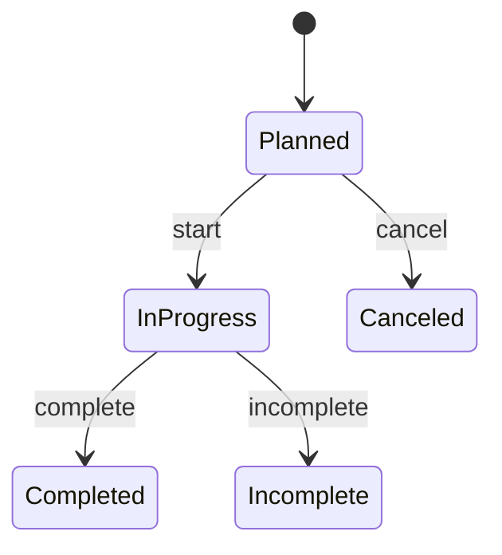

# Management Solutions

A fleet-management REST API for trucking dispatch, built with Django and Django REST Framework. Dispatchers manage trucks, drivers and trips, and every trip moves through a validated lifecycle that keeps driver and truck availability consistent.

## Features

- **Fleet CRUD** with business-rule validation for trips, trucks and drivers.
- **Trip state machine** covering the full lifecycle: planned, in progress, completed, canceled and incomplete.
- **Scheduling conflict detection** for drivers and trucks across planned and active trips.
- **JWT authentication** with refresh-token rotation, blacklisting on logout, and a throttled login endpoint.
- **State-aware editing.** Which trip fields can be edited depends on the trip's current status (for example, route and times are locked once a trip is in progress).
- **Race-condition protection.** Assignments and state transitions run inside `transaction.atomic` with `select_for_update()` row locks.
- **Test suite** (pytest) covering models, services, the API and permissions.

## Tech stack

Python 3.14, Django, Django REST Framework, Simple JWT, PostgreSQL, pytest

## Architecture

```
api/                     Viewsets, serializers, permissions, error handler
  tests/                 Role authorization, authentication and endpoint tests
core/
  models/                Domain models and validation rules (Truck, Driver, Trip)
  services/              Business logic, transactions and locking
  repositories/          Data-access helpers
  tests/                 Model, service and state-machine tests
management_solution/     Project settings and root URLs
```

Requests flow in one direction: **view → service → repository / model**.

## Getting started

### Prerequisites

Python 3.14 and a running PostgreSQL server. If you don't have PostgreSQL installed, the quickest option is Docker:

```bash
docker run --name fleet-db \
  -e POSTGRES_PASSWORD=password \
  -e POSTGRES_DB=management_solution \
  -p 5432:5432 -d postgres:16
```

### Installation

```bash
git clone https://github.com/GurjodhSandhu/Management_Solutions.git
cd Management_Solutions

python -m venv venv
source venv/bin/activate        # Windows: venv\Scripts\activate
pip install -r requirements.txt
```

### Configuration

Create a `.env` file in the project root:

```env
DJANGO_SECRET_KEY=change-me
DJANGO_ALLOWED_HOSTS=localhost,127.0.0.1
DB_NAME=management_solution
DB_USER=postgres
DB_PASSWORD=your-password
DB_HOST=localhost
DB_PORT=5432
```

### Database

```bash
python manage.py migrate
python manage.py createsuperuser
python manage.py shell -c "from django.contrib.auth.models import Group; [Group.objects.get_or_create(name=n) for n in ('admin', 'dispatcher')]"
```

Superusers can use the API immediately. Other users need to be added to the `admin` or `dispatcher` group in the Django admin at `/admin/`.

### Run

```bash
python manage.py runserver
```

The API is served at `http://localhost:8000/api/`. Log in with the superuser you created, then send the access token as a Bearer token:

```bash
curl -X POST http://localhost:8000/api/token/ \
  -H "Content-Type: application/json" \
  -d '{"username": "your-username", "password": "your-password"}'

curl http://localhost:8000/api/trucks/ \
  -H "Authorization: Bearer <access-token>"
```

Access tokens last 15 minutes and refresh tokens 7 days. Refresh tokens rotate on use and are blacklisted after rotation or logout.

### Tests

```bash
pytest
```

## API reference

| Method | Endpoint | Description |
|---|---|---|
| POST | `/api/token/` | Log in and receive access and refresh tokens (throttled to 5/min) |
| POST | `/api/token/refresh/` | Exchange a refresh token for a new access token |
| POST | `/api/logout/` | Blacklist a refresh token (`{"refresh": "..."}`) |
| GET | `/api/me/` | Current user's id, username and role |
| GET, POST | `/api/trucks/` | List or create trucks |
| GET, PATCH, DELETE | `/api/trucks/{id}/` | Retrieve, update or delete a truck |
| GET, POST | `/api/drivers/` | List or create drivers |
| GET, PATCH, DELETE | `/api/drivers/{id}/` | Retrieve, update or delete a driver |
| GET, POST | `/api/trips/` | List or create trips |
| GET, PATCH, DELETE | `/api/trips/{id}/` | Retrieve, update or delete a trip |
| POST | `/api/trips/{id}/assign_driver/` | Assign a driver (`{"driver": <id>}`) |
| POST | `/api/trips/{id}/assign_truck/` | Assign a truck (`{"truck": <id>}`) |
| POST | `/api/trips/{id}/start/` | Planned → in progress |
| POST | `/api/trips/{id}/complete/` | In progress → completed |
| POST | `/api/trips/{id}/incomplete/` | In progress → incomplete |
| POST | `/api/trips/{id}/cancel/` | Planned → canceled |

## Trip lifecycle



| State | Required fields | Rules | Previous | Next | Effects |
|---|---|---|---|---|---|
| **Planned** | start, end | None | Default | In progress (start), Canceled (cancel) | None |
| **In progress** | start, end, truck, driver, departure_time, arrival_time | Truck and driver cannot be on a conflicting active trip | Planned | Completed, Incomplete | Marks truck and driver unavailable |
| **Canceled** | start, end | None | Planned | None | None |
| **Completed** | start, end, truck, driver, departure_time, arrival_time | None | In progress | None | Releases truck and driver |
| **Incomplete** | start, end, truck, driver, departure_time, arrival_time | None | In progress | None | Releases truck and driver |
